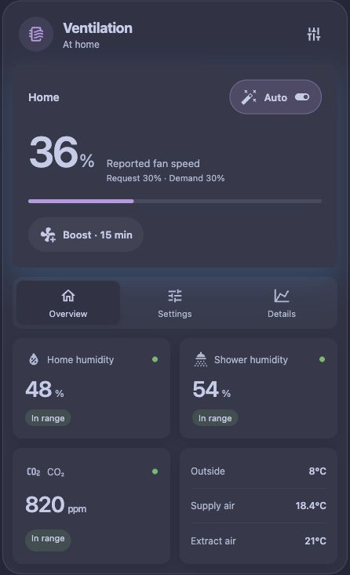

# Vallox Autopilot

A Home Assistant integration and bundled dashboard card for gradual, configurable ventilation using an existing native **Vallox MV** integration.



## Install

1. Install the native Vallox integration and confirm its fan, humidity, CO₂ and temperature entities work.
2. Add `https://github.com/bitosome/vallox-autopilot` to HACS as an **Integration**, download and restart Home Assistant.
3. Add **Vallox Autopilot** in Settings → Devices & services. Select the native fan, dry-house humidity sensors, shower humidity, CO₂ and heat-recovery/outdoor sensors. Leave the occupancy input empty to use the integration’s shared Home mode switch (`on` = Home, `off` = Away). For sauna detection, choose heater current sensors in amperes, or an existing external sauna binary sensor. Keep shower sensors out of the dry-house group.
4. Add the **Vallox Autopilot** dashboard card and select its Status sensor. The module registers automatically; YAML dashboards can load `/vallox_autopilot/card.js?v=0.5.1` as a JavaScript module.
5. Review settings before turning Auto on. New controllers start **off**.

```yaml
type: custom:vallox-autopilot-card
entity: sensor.vallox_autopilot_status
name: Ventilation
```

## Control policy

- Independent dry-house humidity, shower absolute humidity, shower excess over the dry-house mean, and CO₂ demands. The highest demand wins.
- Linear interpolation between configurable start/full-boost thresholds. Home/away baselines, maximum boost, up/down ramp and release delay are configurable.
- Sauna suppresses **this controller's** humidity demand. CO₂ and manual boost remain available. Native Vallox RH/CO₂ sensors may still increase actual airflow independently.
- Winter optionally lowers humidity thresholds below a configurable outside temperature. This is a configurable condensation-management policy, not a substitute for dew-point/surface-temperature measurement.
- Manual Boost is a timed demand. It immediately requests the configured boost speed, works with Auto off, and restores the prior requested speed when it expires if nobody changed the fan. With Auto on, natural expiry falls gradually after the release delay. Pressing Stop boost explicitly returns immediately to current automatic demand, without that delay or ramp. Active humidity/CO₂/fallback demand, external overrides and native protection still apply. A stop waiting for protection is retained across restart.
- Home/Away native profiles only. Fireplace, Extra, Auto, native Boost, fan off, unavailable heat-recovery state and defrost suspend writes. The controller never shuts off ventilation, changes fan balance, bypass, heaters or defrost parameters.
- Changing the native requested percentage creates a temporary manual hold. Native **measured** speed changes do not. Resume releases a hold; Auto must be on for ongoing automatic control.
- Missing/stale sensor readings use at least the configured home baseline; known high CO₂/humidity demands may still increase speed. Missing sauna state inhibits controller humidity boost.
- Shared settings, Auto state, timed-boost deadline, override hold and recent command history persist in Home Assistant. Back up HA configuration including `.storage`; ordinary restarts and integration updates preserve them.

The defaults are starting values, **not commissioned airflow rates**. Set the minimums according to your unit's ventilation commissioning and house needs. Units supported: humidity `%`, CO₂ `ppm`, temperature `°C`. Sensors must report within the configurable freshness interval. Available ESPHome entities on a connected API are allowed to retain unchanged readings; disconnected or sleeping devices do not get this exemption. The card names unusable inputs and their reasons.

## Entities and settings

One device contains Status, dry-house/shower humidity, CO₂, target speed, Automation and Home mode switches, Sauna active binary sensor, Boost / Cancel boost / Resume buttons, and number entities for all thresholds/timers/speeds. All users see the same settings. Native entity services allow automations, Companion/Watch and physical-switch integrations without wrapper scripts.

The Settings tab shows compact response-curve summaries for house humidity, shower humidity, shower rise above the house average and CO₂. Select a summary to open its focused editor. The interaction takes inspiration from [FanControl’s graph editor](https://getfancontrol.com/docs/#graph): drag points, tap unused graph space to add a point, and select point chips for precise numeric edits. Comparison with the other occupancy curve is optional. Choose the Home or Away occupancy curve, drag a point in both directions, or use arrow keys / the selected point’s numeric fields. Add point inserts a point on the existing line; Remove point removes the selection. Each curve supports 2–12 ordered points. Speed cannot decrease as humidity/CO₂ increases, and global baseline/maximum speeds remain authoritative. The graph holds its scale during editing; Fit reframes the points. This keeps touch targets stable; numeric fields can move a point anywhere within its allowed input range.

Edits save automatically on release/commit through `vallox_autopilot.set_response_curve`, targeting the card’s Status entity. The backend stores curves and per-curve revisions in its HA Store, shared by all users and retained across updates/restarts. A stale concurrent edit is rejected; the card retains the draft and offers Reload shared curve or Retry. There is no browser-only authoritative setting and no service call on every drag movement. Cancelling a pointer gesture discards it.

Without a custom curve, existing start/full thresholds generate exactly the previous two-point response; upgrading does not change demand. Those legacy threshold entities still define RAG badge warning levels and default curves. Once a curve is customized, its saved points define fan demand independently of those thresholds. Home/Away here means occupancy, not switching the native Vallox profile. Winter advances house/shower response by the configured RH reduction; the editor displays normal coordinates and explains the shift. The highest demand wins, then ramp/cooldown rules apply; actual fan speed can still differ under native control.

For automations, `set_response_curve` takes `curve` (`home`, `shower`, `excess`, `co2`), `profile` (`home` or `away`), `points` (objects with input `x` and requested fan-percent `y`), and `expected_revision` from Status attribute `curve_revisions["curve:profile"]` (zero if missing). Status publishes the effective `response_curves`, including global speed bounds. Entity-service permissions apply.

Configure entity mappings in the integration options. Use the card's Settings tab or number entities for individual values; use the options Tuning form to change interdependent thresholds together. Validation enforces `away ≤ home ≤ boost` and `start < full`. The card resolves entity IDs from the integration, so renaming entities is supported.

Home mode is shared and persisted across restarts and updates. When using an external occupancy entity, the internal Home mode switch is unavailable. Scenes can control the Home mode switch directly; no helper is needed.

Sauna detection uses the highest configured heater-current reading: above 1 A for 5 seconds activates it; all currents below the threshold for 15 minutes release it. These values are configurable. Missing current data makes Sauna active unavailable and inhibits controller humidity boosts. An active sauna survives restart with a fresh cooldown, so thermostat pauses do not prematurely enable humidity boosts.

The History tab embeds Home Assistant’s native history graphs, like the NIBE card. Choose Fan speed (reported speed and controller target), Humidity, CO₂ or Temperature, and 6/24/72 hours. Graphs use configured entity mappings, including renamed entities, and HA Recorder history. Missing samples remain gaps. Details records the latest 40 control decisions and interruptions. RAG labels reflect configured operating thresholds, including low-humidity warnings; they do not certify indoor air safety.

## Native Vallox and winter

Read [native settings and winter](docs/native-settings.md) before changing the unit's own settings. Requested speed and actual speed are deliberately separate. Native demand control can raise actual speed above our request; protections can also change operation.

## Development

```sh
npm ci
npm run check
python3.14 -m venv .venv
.venv/bin/pip install -r requirements-test.txt
.venv/bin/python -m unittest discover -s test -p 'test_*.py' -v
python3 -m http.server 8774 --bind 127.0.0.1
# http://127.0.0.1:8774/preview/ — synthetic data, no hardware calls
```

The controller is the only command writer; `engine.py` is pure policy, native HA platforms expose shared state, and the Lit card only calls entity services. Space Hub design tokens and glow helper are vendored with provenance; NIBE supplies the compact visual hierarchy. No runtime dependency on sibling repositories or cloud services.

The control binding must be an enabled native `vallox` fan, and Autopilot output entities cannot be mapped back as inputs. The controller writes `fan.set_percentage` directly; core Vallox sends that setting to the unit over its local API. No legacy helper or automation is part of this write path. Requested percentage and reported operating speed remain distinct.
